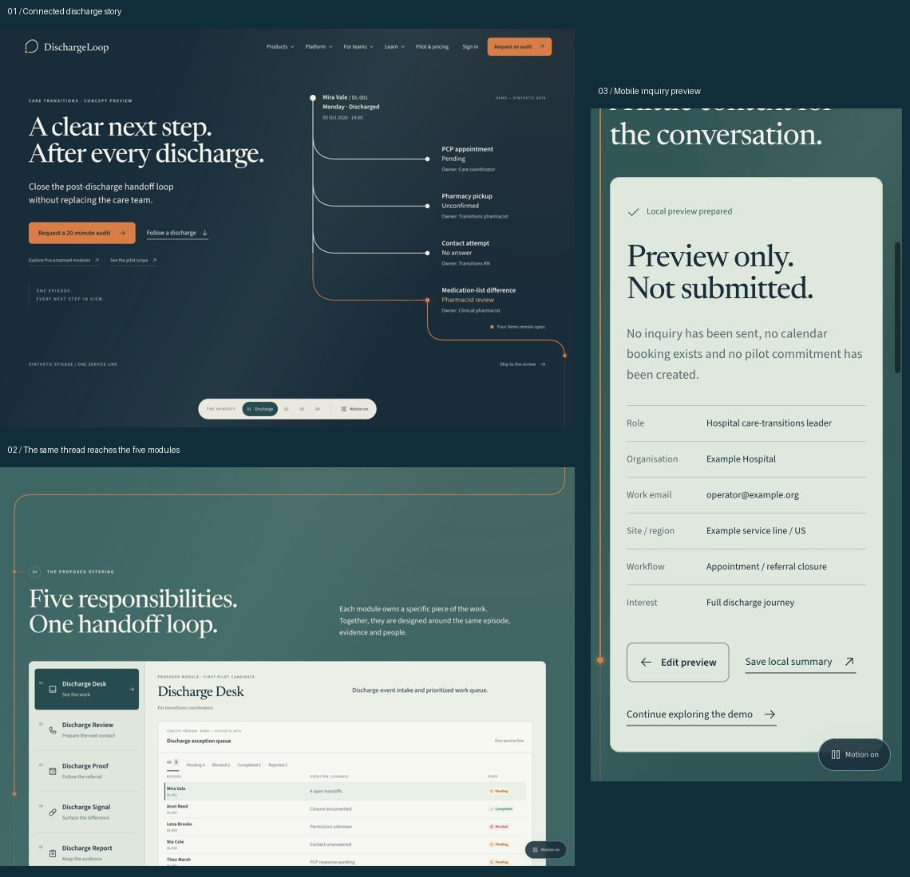

# DischargeLoop connected story design QA

final result: passed

## Scope and visual truth

The selected Safe Harbor image is `qa/source-safe-harbor.png` (1122 × 1402 source pixels). The subsequently approved brand system in `../dischargeloop-brand-kit/brand-board.png` supplies the final outlined logo, exact palette, Newsreader and Source Sans 3. The current request expands the static concept into four story beats, so the additional handoff chapter and source-review states are intentional. This is not a claim of pixel-identical reproduction of the earlier generated image.

Implementation: http://localhost:8732/

## Captures and comparisons

- `qa/desktop-final.jpg`: rendered hero, 1440 × 1000 CSS and screenshot pixels, density 1.
- `qa/desktop-owners.jpg`: ownership chapter at 1440 × 1000.
- `qa/desktop-review-final.jpg`: human review, source strip and complete unsent draft at 1440 × 1000.
- `qa/mobile-hero.jpg` and `qa/mobile-workbench.jpg`: 390 × 844 mobile frames, density 1.
- `qa/desktop-short-final.jpg`: final review scene at 1280 × 720 after short-screen fixes.
- `qa/comparison-hero.jpg`: source scaled uniformly to 1440px wide and cropped to the same 1000px hero region, beside the implementation.
- `qa/comparison-owners.jpg`: normalized source owner chapter beside the implementation at its matching chapter. The panel contains four required tasks rather than the source image's three-row simplification.
- `qa/comparison-detail.jpg`: focused identity and owner-ledger regions. Crops preserve aspect ratio and do not stretch either design.

Combined comparison images were opened and visually reviewed. The implementation captures show real browser rendering, not generated UI images.

## Comparison history and fixes

1. [P2, resolved] Hero headline initially wrapped into three lines on desktop. Reduced desktop type within the approved brand range so it retains the intended two-line composition. Evidence: `desktop-initial.jpg` versus `desktop-final.jpg`.
2. [P2, resolved] Mobile reading order initially put the draft before the human-review explanation. Mobile now stacks ownership explanation, human-review explanation and the workbench. The selected evidence and full unsent draft remain reachable in normal document flow. Evidence: `mobile-workbench.jpg` and mobile browser review.
3. [P2, resolved] At 720px desktop height, story controls overlapped the draft/end label. Tightened short-screen matrix spacing and moved the endpoint label to the right; the full draft and its unsent status now clear the controls. Evidence: `desktop-short-final.jpg`.
4. [P2, resolved] The route extension approached the hero's status caption. Moved the caption clear of the path and corrected the outer route bend. Native SVG diagram geometry is required by the user for a moving, connected route, rather than substituting a bitmap asset.
5. [P3, acceptable] Final Newsreader letterforms differ from the exploratory generated image; they match the subsequently approved brand system. CTAs have dark text on buoy orange, also matching the contrast-checked brand system rather than the image's white-on-orange labels.

## Required fidelity surfaces

- **Fonts and typography:** Local variable Newsreader for display, Source Sans 3 for UI/body. Serif/sans hierarchy, two-line desktop hero, readable mobile headings, and tabular timestamps verified visually. No fallback font flash remains in settled captures.
- **Spacing and layout:** Warm spacious hero, right-hand route, curved light-to-teal transition, pale owner ledger, dashed unsent draft and clear chapter controls retained. Sticky desktop workbench; normal mobile reading flow. Short-screen layout checked separately.
- **Colours and tokens:** Approved paper #F5F1E7, teal #174D50, ink #102D3A and orange #E77737 are retained. Paper warms to #F2E6D4 with scroll; review darkens to ink. Semantic statuses include text; no task silently becomes completed.
- **Asset fidelity and quality:** Supplied outlined brand logo and favicon reused. Self-hosted licensed fonts. Phosphor functional icons. No patient/boat photos, decorative generated UI images, placeholder imagery or third-party customer marks. Code-native route lines are the explicitly requested animated workflow diagram.
- **Copy and content:** Four exact scenario handoffs retained, fictional owner roles, dated next review, source IDs and open episode status. Draft remains unsent; source differences remain for professional review. Core thesis preserved. No live integration, clinical outcome, billability or compliance claim.

## Interactions checked in the browser

- Chapter navigation, hero follow action and skip-to-review scroll destinations.
- Four-item selection and owner-row selection update the selected issue/source.
- Source modal opens with source ID, episode, reviewer, timestamp, excerpt and open-review explanation; Close and Escape return to the story.
- Mobile menu opens and selection closes it.
- Motion toggle exposes complete draft/still states.
- Draft replay observed at partial text `Hi Mira`, followed by the complete 108-character text. It stays marked unsent.
- Local audit form accepts example organisation and email, then displays “Preview complete. No request has been sent.”
- Document width equals viewport at 390px and 1440px; no page-level horizontal overflow observed.
- Browser log inspection returned no warnings or errors in the final pass.

## Build checks

- `npm run build`: passed after final changes.
- `npm run test:sites`: 4 tests passed for the starter's serving/packaging contract. These do not substitute for the browser checks above.

## Limits and follow-up polish

The explicit still-mode control was tested; the operating-system reduced-motion setting was not separately emulated. Cross-browser/device hardware testing, live form delivery, authentication, full-site routes and deployment are outside this first-sequence prototype. A later polish pass can tune the route pacing against user scrolling speed. No unresolved P0/P1/P2 issue remains in the checked prototype scope.

## Browser annotation follow-up

Both requested changes are complete. The supplied 775 × 804 browser annotations identified line/node gaps and asked for a stronger background transition.

- Replaced the stretched fixed-viewBox diagram with coordinates measured from the actual origin and handoff targets. Every path endpoint and node centre share the same geometry. Removed the separating node outlines and nonuniform scaling. Added an uninterrupted common trunk before the orange final branch.
- At 775px and 390px, browser measurements returned deltaX=0 and deltaY=0 for all four circles versus their target anchors. Every circle measures 11 × 11 CSS pixels. No page overflow at either width.
- The scroll-linked background now moves from warm paper through sea-glass #DDEAE4 to harbor teal #174D50 during the first sequence, then deepens to ink at human review. Foreground colours are selected using calculated contrast during the transition; selected light surfaces retain their dark text.
- Observed the settled 775px dark state: background rgb(23,77,80), foreground rgb(245,241,231), secondary rgb(196,214,208). Scrolling up restores the light state. Explicit still mode restores stable readable surfaces.
- New screenshots: `qa/route-aligned-775.jpg`, `qa/background-dark-775.jpg`; combined proof `qa/annotation-fixes.jpg`.
- Source visuals for this revision: the two user-supplied browser annotation screenshots in the current chat. They were inspected alongside the revised browser captures. These are local fixes to the selected route and background; the story content and approved brand assets are retained.

Follow-up result: passed. No unresolved P0/P1/P2 finding from the two annotations remains in the checked views.

## Complete homepage extension — 16 October 2026

Final homepage result: **passed in the checked local scope**.

The user asked to finish the homepage using the brief, completed research, brand kit, IA and website structure. The four approved opening beats and their subsequent line/background corrections are retained. New homepage chapters use the same paper, sea-glass, teal, ink and buoy-orange system, Newsreader/Source Sans 3, original brand assets and restrained borders. The native interfaces are real HTML; no generated screenshot is used as a functional product view.

### Visual evidence

- `qa/homepage-hero-desktop.jpg`: current 1440 × 1000 opening.
- `qa/homepage-modules-desktop.jpg`: all nine queue records and five module controls at 1440 × 1000.
- `qa/homepage-teams-desktop.jpg`: secondary-buyer ACO workflow.
- `qa/homepage-oversight-desktop.jpg`: dark oversight chapter and blocked case.
- `qa/homepage-evaluation-desktop.jpg`: proposed methodology and empty baseline/pilot scorecard.
- `qa/homepage-pilot-desktop.jpg`: pilot path and hypothetical pricing.
- `qa/homepage-hero-mobile.jpg`, `qa/homepage-modules-mobile.jpg`, `qa/homepage-footer-mobile.jpg`: 390 × 844 browser views.
- `qa/homepage-dark-775.jpg`: preserved 775px dark scroll state.
- `qa/homepage-comparison.jpg`: previous approved opening beside the extended homepage opening, plus the new module and oversight chapters. Images were uniformly resized without stretching and opened for visual comparison. The older opening capture predates the accepted route correction; current measured joins remain the source of truth.

Typography, page gutters, heading hierarchy, calm light/dark surfaces, rounded controls, semantic statuses and original logo treatment are consistent across the inspected old and new chapters. Mobile has stacked layouts and legible source/queue labels; the module selector uses large touch targets. No generic customer logo strip, invented testimonial or placeholder social link was added.

### Browser checks completed

- Main product dropdown opens, selects a module and closes on navigation. Mobile menu exposes all five offers and the audit CTA.
- All five module views render their distinct workflows. Module details include audience, inputs, outputs and review boundaries.
- ArrowDown changes Desk to Review; End selects Report and updates the associated tabpanel.
- Medication source action opens the attributed evidence dialog; Escape and Close work.
- Module-detail CTA opens the full audit form.
- The form accepts example business details, validates required fields and acknowledgement, and displays “Preview complete. No request has been sent.” Nothing is transmitted.
- The clean and blocked case tabs display their own fictional sources, review times and outcomes. Missing permission remains blocked/abstained.
- Hospital and ACO tabs show distinct workflows. Readiness gates and FAQ answers expand. Privacy notice opens and closes.
- All internal hash anchors resolve; there is one H1.
- Page width equals viewport at 1440, 775 and 390px. No page-level horizontal overflow.
- At 390 and 775px, all four handoff nodes remain at deltaX=0 / deltaY=0 against their measured anchors.
- At 775px with motion on, the settled opening field is rgb(23,77,80) with foreground rgb(245,241,231). Still mode restores static readable content.
- Browser warning/error log inspection returned an empty list.

### Coverage and limits

`homepage-coverage.json` records the brief-to-section mapping. The exact five offers, single-service-line first scope, three cases, hypothetical price, evaluation guardrails, 8/2/1 prerequisites, signed-approval conditions and stop rule are present. Pricing is explicitly hypothetical. Product availability and evidence limitations stay visible.

No unresolved P0/P1/P2 issue remains in the checked homepage. The local frontend is complete; live form delivery, authentication, independent module routes, tracking, cross-browser hardware testing and deployment are not represented as finished. The system reduced-motion path is implemented; the explicit still-mode control was browser-tested, while a separate OS preference override was not emulated.

## Continuous-page correction — user annotation follow-up

The user correctly identified that the added homepage chapters had become separately painted blocks and that the bridge’s orange path ended at its section edge. The previous homepage pass did not meet the requested full-page continuity. This revision supersedes those background/route conclusions above.

- Replaced the opening-only color timeline and fixed chapter backgrounds with one shared canvas across the entire homepage. All narrative chapter wrappers, the bridge and footer now compute to transparent backgrounds. Only actual product surfaces retain their own neutral fill.
- Scroll blends the canvas through the approved paper, sea-glass, harbor teal and ink palette. Narrative text and secondary copy select readable foreground colors during the blend. Scrolling upward reverses the color transition.
- Removed the isolated bridge SVG and the short outer story connector. One measured path now begins at the hero’s final orange node, follows the story, crosses the bridge and runs through all remaining chapters to the footer. It remains the approved buoy orange. The line is a decorative, aria-hidden relationship cue; all chapter names and state information remain available as text.
- Chapter nodes/branches share the same measured coordinates as that path. The drawing frontier stays below the viewport, preventing an apparent end at a visible section boundary. There is no mobile cutoff.
- ResizeObserver and font/viewport events re-measure the path. At 390px, expanding the readiness gate grew both natural main height and SVG height from 19,488 to 19,819px; collapsing it restored both to 19,488px.
- Browser measurements retained deltaX=0 and deltaY=0 at all four hero targets on the 390px view. Page width matched viewport at 390, 775 and 1440px. All inspected chapter backgrounds were transparent. Full-page scroll sampling showed successive background changes and steadily advancing path dash offset.
- Still mode displays the complete route on one stable paper canvas; footer text/logo adapt to that light surface. Motion-on restores the changing canvas. Native dialogs and the privacy notice remain functional. Final browser logs contained no warnings or errors.

Evidence: `qa/continuous-bridge-775.jpg`, `qa/continuous-bridge-desktop.jpg`, `qa/continuous-mobile-390.jpg`, `qa/continuous-oversight-775.jpg`, and `qa/continuous-footer-desktop.jpg`. Captures were visually reviewed against the user’s annotated bridge screenshot. The visible hard color seam and disconnected path are removed. Some earlier captures preserve intermediate color/contrast tuning; the live implementation and final bridge captures reflect the final motion system.

Build and all four serving/packaging tests passed after this correction. No unresolved continuity issue remains in the inspected breakpoints. Separate hardware and OS reduced-motion emulation remain outside these browser checks.

## Complete multi-page website — final full-site phase

**Final result: passed for the local frontend website scope.**

The latest instruction expands the approved homepage into all supporting IA routes, explicitly adds sign-in, and asks for less white/cream. The site now contains **33 substantive pages plus a custom 404**, with a complete route register in `site-map.json` and requirement mapping in `website-coverage.json`.

### Design and reference review

The user-supplied recording contact sheet (`work/dawn/contact.jpg`) and approved Safe Harbor brand board were inspected again. The adoption is Dawn’s connected environments, sustained route motif, controlled reveals and product-specific motion—not its photographs, customer claims or identity. The approved Newsreader/Source Sans 3, outlined mark, favicon and buoy orange are reused. Harbor ink and teal now dominate the canvas; sage chapters provide limited contrast. Neutral fills belong to actual UI, not alternating page blocks.

The homepage’s measured hero joins are preserved: all four node/target deltas remained zero at the checked desktop view. Supporting pages each have one measured route, transparent chapter containers and shared canvas interpolation. Product pages use distinct queue, draft, referral, source-comparison and evidence-packet compositions. Other destinations use editable local demonstrations, editorial guides, source registers, operating maps and actual form states rather than empty templates.

Real browser captures were visually reviewed for typography, spacing, alignment, contrast, surface consistency and mobile reading order. `qa/full-site/website-overview.jpg` composes two unaltered browser captures at a uniform scale for comparison; it does not depict generated product imagery.

### Route and responsive evidence

- `route-audit-desktop.json`: all **34** destinations at 1440 × 1000; one H1, one main route, valid internal hash targets, no broken images, no page overflow.
- `route-audit-mobile.json`: the same **34** destinations at 390 × 844; every route renders, and document width equals viewport. No out-of-bounds content was reported.
- `route-audit-tablet.json`: homepage, Signal, sign-in and demo checked at 775 × 804, with no page overflow.
- `alias-audit.json`: pricing → pilot commercial model; results → evidence; about → company; integrations → readiness; trust/security → oversight; privacy/terms → their legal pages.
- `motion-audit.json`: product, company, sign-in and legal pages each produced three different scroll-sampled background colors. All narrative wrappers computed to transparent backgrounds.
- The shared still setting survives client navigation. Still mode showed the complete route at zero dash offset, complete unsent draft and stable ink canvas. Explicit mode tested; separate OS-preference emulation was not performed.

### Functional browser checks

- Desktop product menu navigates to an actual module page. Mobile menu exposes all five products, portfolio, demo, platform, buyer paths, resources, pricing, sign-in and audit routes.
- Product source dialog showed fictional DEMO-M04 present in DS-DEMO-001 Version A and absent in SOURCE-DEMO-002 Version B, with no conclusion about the correct medication list. Escape closes the dialog.
- Product CTA preserved `module=signal` and selected Signal in the inquiry. The workflow question prefills medication-list review. Native required-field validation prevented an empty inquiry.
- Example business fields and preview acknowledgement produced the explicit **“Preview only. Not submitted.”** result, with no booking or pilot commitment claimed. Edit/local-summary paths are present.
- Password show/hide changed the example input type. Password and secure-link previews explicitly reported no authentication/email. Example passwords clear after preview. Access-help reported **“No recovery message sent.”**
- Demo filter returned exactly two blocked records. Lena’s missing-permission draft stayed blocked; simulated acknowledgement recorded an attributed/resettable note without changing the seeded state. Source details correctly showed Lena / DL-003 rather than Mira.
- Search with no matching fictional record showed the empty state and working clear control. Reset restored the full queue.
- Arun’s clean case showed the seeded fictional contact, appointment/attendance, source-review and coordinator-closure checklist. It is explicitly not a clinical/billing eligibility checklist.
- Keyboard End switched Evidence to Timeline in the demo tablist. Generic page tablists support arrow keys, Home and End; selected tabs receive the normal tab stop.
- Unsent typing was observed at partial **“Hi Mira, your”**, then the complete draft. No sent state exists.
- The blank evaluation worksheet was actually downloaded through the browser. It contains methodology fields and “not measured” values, not invented results.
- The source, timeline, review-acknowledgement and export controls remain isolated from live services. No external record, lead, identity or clinical system is connected.

### Build and production preview

- Final `npm run build`: passed; separate application, vendor and motion bundles, with no oversized-chunk warning.
- `npm run test:sites`: all four original serving/packaging tests pass.
- A separate compiled-build preview on localhost:8733 was tested, including home, Signal, demo, sign-in, audit, source notes, privacy and custom 404. `production-audit.json` records representative loads. Fresh production-browser logs returned no warnings or errors.
- Incremental dev editing briefly produced historical HMR reload messages while files were being created. They were not present in the fresh compiled-build verification.

### Final screenshots

`home-desktop.jpg`, `signal-desktop.jpg`, `sign-in-desktop.jpg`, `demo-workbench-full.jpg`, `demo-desktop.jpg`, `demo-mobile.jpg`, `sign-in-mobile.jpg`, `mobile-menu.jpg`, `audit-result-mobile.jpg`, `sign-in-result-mobile.jpg`, and `story-review-1440x810.jpg` are under `qa/full-site/`. The 1440 × 810 review frame supplies a 16:9 capture of owners, sources, complete unsent draft and human-review boundaries. The separate 390px captures use stacked content rather than shrinking desktop UI.

### Scope and remaining production integrations

No unresolved P0/P1/P2 frontend issue remains in the checked site. Live identity, form/email/calendar delivery, patient/source feeds, analytics, actual pilot validation, production legal review, GitHub/Vercel/domain publication and broader hardware/assistive-technology testing are not represented as completed. This is the complete concept website and synthetic frontend, not an operating clinical product. Those boundaries are visible in the relevant pages.

## Refinement review — brief, IA, continuity and motion

Reviewed again against the complete supplied execution brief, the saved Research and Website IA Page, the approved Safe Harbor kit, and new adjacent frames extracted from the original Dawn recording (4.4/5.2, 9.4/10.2 and 53.5/54.2 seconds). The recording's useful patterns are a visible drawing frontier, staged evidence, changing color environments and bounded depth. Its branding, assets and claims are not copied.

1. **Content and architecture — covered.** All 33 requested website pages plus recovery/404 were opened in the browser. All five proposed responsibilities remain in order, with dedicated job/input/workflow/reviewer/output/evaluation/FAQ pages. Hospital and ACO paths, nine synthetic cases (4 pending / 2 blocked / 2 completed / 1 rejected), source-linked professional review, unsent drafts, commercial hypothesis, 8/2/1 prerequisites, signed approvals, baseline/denominator/guardrails, incumbent stop conditions, research limitations and acquisition routes remain present. The IA's campaign/tracker plans remain planning material rather than public customer claims or deployed analytics. Added the missing near-hero shortcut to all five modules and the pilot, and added Why handoffs break to the complete footer map.

2. **Background and orange route — passed at desktop and mobile.** Fresh route scans cover all 34 destinations at 1440px and 390px. Every narrative wrapper is transparent; each uses the shared canvas. Every destination produced a different background at the sampled middle position and returned to ink at the footer. Every main route is one continuous subpath, with the same geometry in its faint continuation and bright progress stroke. Desktop origin-to-dot offset measured zero on all 34 pages. The four homepage branches measured zero x/y error at 320px, 775px and 1024px. Route height re-measured to exactly 4152px after the inquiry result changed the main content height to 4152px.

3. **Mobile and interaction quality — refined and checked.** No horizontal overflow on any of the 34 destinations at 390px. Six key page types also fit 320px, 775px and 1024px. Inquiry pages now have a primary form jump; mobile removes the redundant large illustration and puts the form before the agenda. Headline balance, touch targets for guide/footer navigation, focus behavior, frame depth and link arrows were refined. Native validation blocked an empty inquiry; example fields produced only “Preview only. Not submitted.” Sign-in still produced an explicitly isolated preview. Lena's local acknowledgement preserved Blocked, with an attributed/resettable note. No internal destination or in-page hash was missing in the fresh desktop scan.

### Added motion

- A faint full-length orange track keeps the route continuous ahead; its stronger drawing frontier now sits at 82% of the viewport and has a restrained ring, so progress can actually be seen.
- Harbor light moves across the same global canvas with scroll. No independent section backgrounds or perpetual animation loop were added.
- Evidence/source pairs, input contracts, role lists, scorecard rows, readiness gates and engagement stages assemble in sequence.
- Product hero visuals have a bounded scroll-linked depth shift; mobile uses a smaller vertical movement.
- Scattered source artifacts enter from different directions. Seal captions, source details and evidence summaries have distinct timing.
- Selected panels and link arrows have short transition states. No animation changes a record, implies a sent message, supplies fake outcomes or closes an unresolved handoff.
- Still mode removes the added transforms, panel animation and light movement; it fully draws the route and shows complete drafts. It remains selected through client navigation. OS reduced-motion preference is read on the initial state to avoid a first-render animation flash; separate OS-preference emulation was not available in this audit.

### Evidence and validation

All files below are in `qa/refinement/`:

- `content-desktop-before.json`, `brief-content-checks.json`: fresh rendered content and coverage checkpoints.
- `desktop-continuity-final.json`: 34 desktop destinations, H1/width/path/origin/link/hash checks and scroll color samples.
- `mobile-continuity-final.json`: 34 mobile destinations, transparent wrappers, connected route/track, width/image checks and scroll color samples.
- `responsive-extremes.json`: 18 additional route/viewport checks and homepage endpoint measurements.
- Numbered before/after screenshots, desktop and mobile contact sheets, and interaction result captures. Mid-scroll captures intentionally include some reveal frames; final overview captures are settled views.
- `npm run build`: passed. `npm run test:sites`: four passed, zero failed. Fresh compiled preview loads on localhost:8733 showed no warning/error logs.

This is a local frontend audit and refinement. It does not establish full accessibility conformance, real-device GPU performance, source-link availability forever, clinical correctness, legal approval, live identity, lead delivery, hosting/domain publication, or pilot demand. No live service, clinical record or external business account was changed.

### Persistent navigation correction

The shared header now stays at top:0 with a solid canvas-colored surface and a higher stacking layer. Anchor jumps, sticky workbench, reading contents and inquiry agenda account for header height. Desktop verified at scrollY 1616: header top 0, menu top 82 / bottom 507 within an 808px viewport. Mobile verified at 390 × 844 and scrollY 787: header top 0, menu starts at 78px with a 766px maximum height and native vertical scrolling. Desktop and mobile menus opened successfully while scrolled. Build passed. Proof: `qa/refinement/sticky-navigation-desktop.jpg` and `sticky-navigation-mobile.jpg`.

## Option 2 introduction — 16 October 2026

**Result: passed the focused intro integration review.** The existing brief/IA pages remain intact. This pass adds the selected Unfinished Ledger direction above the homepage hero; it does not replace the marketing architecture or imply a working clinical service.

### Source and visual fidelity

Approved source: `../dischargeloop-intro-directions/02-unfinished-ledger.png`. The main styleframe and actual browser result were assembled and inspected together in `qa/intro-film/source-vs-implementation.jpg`. The enormous serif event, smaller unfinished-handoff line, four ruled rows, next-owner column, square orange nodes and dark harbor palette are preserved. Original licensed local fonts and supplied logos remain native assets.

Intentional integration changes: the existing sticky navigation replaces the board’s standalone wordmark header; real playback controls replace the board’s production notes; the final rail turns towards the actual hero origin. “An event is not a completed handoff” carries the operational message while the unchanged hero retains the established company tagline. Mobile stacks owners under handoffs with status at the right. The standalone Studio composition also retains the continuation caption; short desktop embeds omit that redundant caption to keep controls visible and type clear.

### Motion and behavior

- Real Studio frames 0, 150 and 359 inspected together in `timing-evidence.jpg`. Frame 0 introduces the event; frame 150 shows the open work; the settled frame includes all four owners and the outgoing line. No handoff is animated into completion.
- Native replay restarted the frame counter and page color. Pause held frame 231 across separate observations. Keyboard End sought to 359; Home returned to the beginning.
- The film plays once and holds at frame 359; no looping. Website playback is muted and contains no audio.
- Scrolling the playing intro out of view paused at frame 11, and the counter remained 11 during later independent checks. Visibility and preference handlers are cleaned up on unmount.
- Use still view showed the complete frame 359, disabled the timeline, exposed Enable motion and retained all owners. System reduced-motion follows the same `useSite().still` path; OS preference wiring was code-reviewed, not changed during testing.
- Skip set the final frame, moved into the existing hero and focused `#discharge`. Sticky navigation remained visible. The overlay chapter controls are hidden while reading the intro so they cannot cover its content.
- No runtime errors in the built homepage. Remotion’s standard developer-console license notice remains; this was not treated as a runtime error or silently acknowledged.

### Continuous canvas and measured route

The embedded composition is transparent. Playback changed the whole app background from `rgb(21,68,74)` near frame 12 to `rgb(18,54,64)` at frame 231, settling at harbor ink. Existing scroll stops then carry the same canvas through the remaining homepage. There is no opaque video background boundary.

At 1280px, the route starts exactly at the measured film exit `[1255,530]` and ends exactly at the hero origin `[700.0234375,705.5]` in main-relative coordinates. At 390px, it starts at `[12,581]` and ends at `[33.5,1402.109375]` in the measured mobile layout. The parsed SVG endpoint and measured dot center agree in both checks (0px endpoint error). The settled continuation has opacity 1. `desktop-continuation.png` and `mobile-continuation.png` show the connected transition.

### Responsive checks and fixes

- 1280 × 720: intro and controls fit the laptop viewport; ruled ledger remains readable.
- 850 × 720: compact desktop ledger tested, including wrapping next-owner roles and the medication label; no horizontal overflow.
- 768 × 1024: fixed the subtitle/Mira overlap by giving the stacked composition its authored aspect ratio. Inspected corrected `tablet-768.png`; no horizontal overflow.
- 390 × 844: all handoffs, owners and native controls visible; inspected `mobile-390.png`; no horizontal overflow.
- 320 × 740: no horizontal overflow; ownership/date sizes have minimums to preserve readability. Playback controls remain reachable by native scroll.
- Orange node centers now align with the first line of each handoff. The rail has a consistent physical stroke width across the film/page join. Mobile continuation copy is offset from the rail to avoid intersection.

### Validation and outputs

- Website `npm run build`: pass; lazy intro 12.92kB and separate film runtime 353.40kB before gzip.
- Website `npm run test:sites`: 4/4 pass. Existing worker/hosting contract preserved.
- Remotion `npm run lint`: ESLint and TypeScript pass.
- Remotion `npm run build`: editable Studio bundle passes. No encoded MP4 was exported.
- Compiled website smoke checks: homepage film mounted and sought to 359 without errors; sign-in and request-audit pages retain their own content and contain no extra intro. The audit form remains present.
- Canonical composition and embedded website copy match. Website and editable film source packages are refreshed without node_modules, Git metadata or temporary Remotion build output.

## Final brief and production-preview QA — 16 October 2026

**Result: pass for the local frontend.** Rechecked the site map and brief traceability after the intro integration, rebuilt the current application, and opened the compiled output in the browser. This final report supersedes earlier scope limitations where later sections record the completed follow-up.

- All 33 substantive routes and the custom 404 are represented in the site map, with eight aliases. The desktop and mobile route audits each cover 34 destinations. Desktop results: no route-count mismatch, missing image, dead hash, incorrect H1 count or horizontal overflow. At 390px, every route resolves and has no horizontal overflow. The saved extreme-width audit contains 18 additional checks.
- All 16 rendered brief checks pass. The five proposed modules remain in their required order; fictional examples, unresolved states, source attribution, human review, pilot gates and hypothetical pricing remain clearly bounded. See `website-coverage.json` and `qa/refinement/brief-content-checks.json`.
- The freshly compiled homepage visibly loads the approved wordmark, favicon, sticky navigation and intro. The compiled request-audit page has its local form; sign-in has its polished local preview fields. Both routes retain sticky navigation, fit the viewport and return no browser errors.
- Current `npm run build` passes. `npm run test:sites` passes all four serving/packaging tests.
- No frontend P0/P1/P2 issue was found in this pass. The one browser warning is Remotion’s standard licensing reminder; it was left visible and must be resolved through the applicable license before commercial deployment.

**Before public launch:** add the chosen hostname’s canonical URL and Open Graph metadata; connect and test authentication and lead delivery only if they are brought into scope; complete legal, accessibility and real-device review. This local concept preview is not a live clinical product. Its audit and sign-in forms do not send data, and the pages make no live integration, patient-outreach, clinical, measured-outcome or compliance-certification claim.

Machine-readable summary: `qa/full-site/final-qa.json`.
